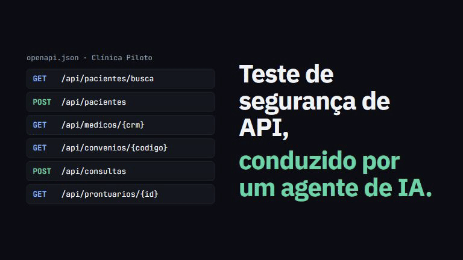

# harness-dast

Ferramenta defensiva para QA testar a segurança de APIs no laboratório local e em ambientes de teste autorizados.

<!-- A animação é gerada pelo projeto Remotion em video/ (veja docs/media/README.md). -->
[](docs/media/apresentacao.mp4)

Clique na animação para abrir o vídeo em tamanho cheio.

## Por que dá para confiar

- **O agente propõe, a CLI executa.** A CLI aplica as regras e os limites da carta.
- A cerca de escopo tem três camadas. A CLI usa o `ScopeGuard`, o ZAP roda em modo protegido e o proxy de saída bloqueia tráfego fora do escopo. [Como funciona a cerca](docs/como-funciona/operacao/authorization-and-scope.md)
- Uma pessoa aprova o escopo em terminal interativo antes do teste.
- O agente usa referências de credenciais, sem receber senhas nem enviar HTTP ao alvo. O hook do Claude Code reforça essas permissões. [Hook de proteção](docs/decisoes/0111-hook-pretooluse-segunda-camada.md)

## Ver funcionando em 3 passos

1. Com Git e `uv` instalados, clone o repositório e rode `uv sync --locked` na raiz. [Instalar a CLI](docs/comecar/instalar.md)
2. Inicie o Docker. Use `uv run hdast stack pull` quando as imagens do ZAP e do proxy estiverem no GHCR. Enquanto aguardam publicação, faça o build local. Prepare também a imagem do VAmPI e as auxiliares, depois rode `uv run hdast doctor`. [Preparar as imagens da demo](docs/comecar/docker.md#preparar-as-imagens-da-demo)
3. No seu terminal, rode `uv run hdast demo`. Leia o resumo e digite `demo` para aprovar o VAmPI local. Ao final, a CLI mostra onde abrir o relatório HTML, se ele foi gerado. [Primeiro uso](docs/comecar/primeiro-uso.md)

A ajuda `uv run hdast --help` reúne os comandos iniciais no painel **Comece por aqui**.

## Testar o seu produto

Abra o Claude Code na raiz do repositório e faça um pedido de cadastro.

```text
Prepare o perfil de teste de <produto> para minha revisão.
Swagger/OpenAPI em <caminho> e carta assinada em <caminho>.
Contas de teste e papéis em <lista de apelidos e papéis, sem senhas>.
Use o escopo da carta e me mostre o resumo antes de qualquer teste.
```

Quando o perfil estiver pronto, rode `uv run hdast setup <produto>` no seu terminal. O comando grava as senhas que faltam no cofre e pede que você aprove o escopo. Depois da execução autorizada, abra `runs/<run_id>/report.html` para consultar achados e lacunas de cobertura. [Cadastro do produto](docs/usar/cadastrar-um-produto.md) · [Carta curta](docs/usar/carta-curta.md)

## O que ele encontra

Falhas plantadas nos alvos do laboratório que a regressão dirigida confere a cada versão:

| Tipo de falha | No laboratório |
| --- | --- |
| Injeção de SQL, inclusive a que só aparece pelo tempo de resposta | Clínica Piloto (H1, H8, H10) e VAmPI (V1) |
| Travessia de caminho | Clínica Piloto (H4, H9) |
| Acesso a objeto de outra conta (BOLA) | Clínica Piloto (H5) e VAmPI (V3) |
| Atribuição em massa | Clínica Piloto (H6) |
| Exposição excessiva de dados | Clínica Piloto (H7) |
| Erro 500 com detalhe interno | Clínica Piloto (H2) |
| Cabeçalhos de segurança ausentes e CORS permissivo | Clínica Piloto (H3) |

Isso é prova de laboratório, não de produto real. [Varredura](docs/referencia/scan.md) · [Escada de testes](docs/desenvolver/escada-de-testes.md)

O `run` já inclui `authz` por padrão e aceita `--authz`. A verificação de acesso entre contas do mesmo papel exige duas contas do mesmo papel. [Autorização entre contas](docs/referencia/authz.md) · [Cobertura e limites de prova](docs/roadmap.md#estado-atual)

## Achar, corrigir, retestar

Depois da correção, use `hdast retestar` para repetir as operações dos achados selecionados da execução anterior.<br>
O `retest.json` indica quais achados reapareceram, quais ficaram ausentes e quais ficaram sem teste. [Referência do reteste](docs/referencia/cli.md#hdast-retestar)

## Aviso de uso autorizado

Use apenas o laboratório local ou um ambiente de teste com dados sintéticos e autorização escrita do dono do produto. Respeite o escopo, a janela e os limites de carga da carta. [Política de segurança](SECURITY.md) · [Finalidade e uso responsável](docs/como-funciona/finalidade-e-uso-responsavel.md)

## Documentação

| Quero… | Vá para |
| --- | --- |
| Instalar e conhecer o laboratório | [Começar](docs/comecar/) |
| Cadastrar um produto ou resolver um problema | [Guias de uso](docs/usar/) |
| Entender a arquitetura e as travas | [Como funciona](docs/como-funciona/) |
| Consultar comandos e formatos | [Referência](docs/referencia/) |
| Contribuir para o projeto | [Desenvolvimento](docs/desenvolver/) |
| Consultar decisões de arquitetura | [Decisões](docs/decisoes/README.md) |
| Consultar provas e revisões anteriores | [Arquivo](docs/arquivo/) |
| Navegar por toda a documentação | [Índice](docs/README.md) |

## Licença

O projeto usa a [licença MIT](LICENSE).
