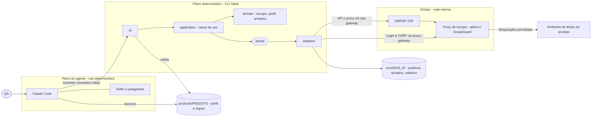
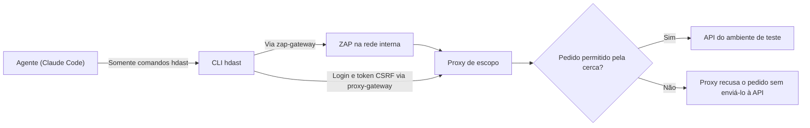
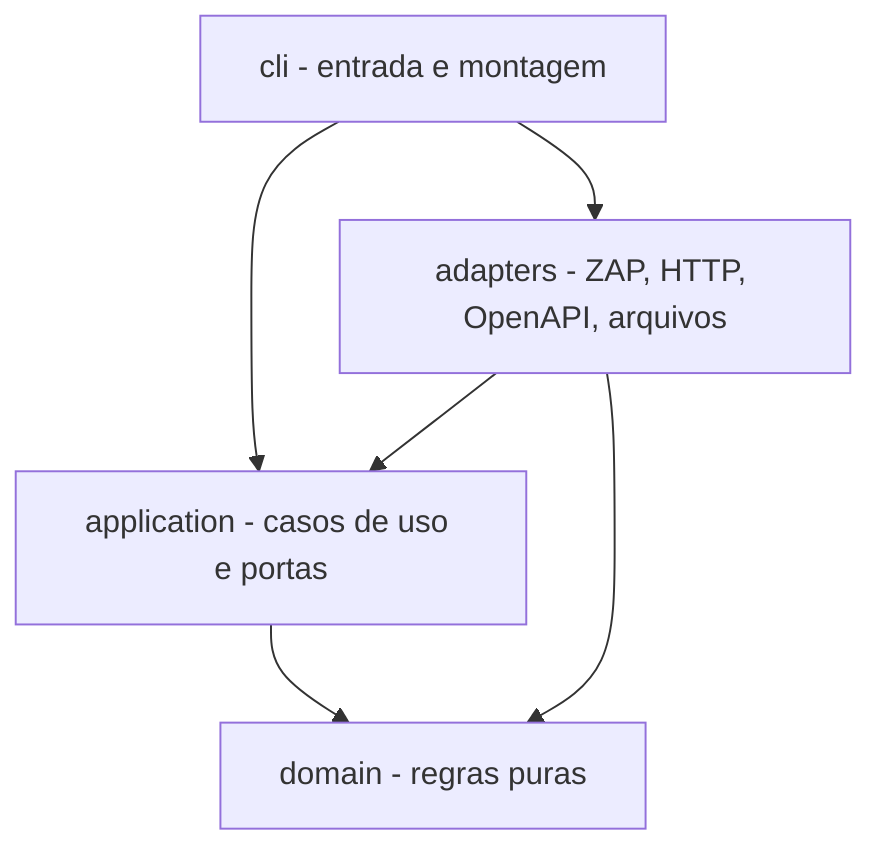

# Arquitetura

Este documento descreve a arquitetura aprovada do `harness-dast`. O [roadmap](../roadmap.md#estado-atual) é a fonte do estado vigente e dos limites de prova por componente.

## Visão geral

O `harness-dast` separa o que é raciocínio do que é execução.

- Um **agente de IA** (Claude Code, com skills em `.claude/`) lê o Swagger/OpenAPI e escreve o perfil do produto.
- Uma **CLI determinística**, `hdast`, valida tudo, impõe o escopo, conduz o OWASP ZAP, gera o relatório e executa a limpeza.

Princípio: **o agente propõe, a CLI executa.** O agente nunca fala HTTP com o alvo, nunca vê segredo e nunca decide escopo. Se ele errar ou for enganado por uma resposta da API, o dano fica limitado ao que a CLI permite. Decisões: [ADR 0001](../decisoes/0001-dois-planos-agente-propoe-cli-executa.md) e [ADR 0002](../decisoes/0002-claude-code-como-runtime-do-agente.md).

Termos usados aqui:

- **OWASP ZAP**: scanner de segurança de aplicações web e APIs. Faz a varredura ativa.
- **Swagger/OpenAPI**: descrição formal dos endpoints de uma API.
- **Perfil de produto**: pasta com `target.yml`, `data-rules.yml` e `flows.yml` que descrevem como testar um produto ([ADR 0005](../decisoes/0005-perfil-de-produto-versionado.md)).
- **Alcançabilidade**: percentual de operações do Swagger que respondem 2xx com os dados gerados. É a métrica principal da V1.
- **Porta**: interface (um `typing.Protocol`, parecido com uma interface Java) que a camada de aplicação declara e um adaptador implementa.

## Os dois planos

| Plano | Natureza | Contém | Pode |
| --- | --- | --- | --- |
| Agente | Não determinístico | Claude Code, skills e subagentes em `.claude/` | Ler o Swagger, escrever arquivos de perfil, chamar comandos `hdast` |
| Determinístico | Código testado | CLI `hdast`, ZAP em Docker | Validar, impor escopo, falar com o alvo, redigir segredos, gerar relatório, limpar |

As skills são roteiros curtos em Markdown: dizem quais comandos chamar e como ler a saída. Se uma skill precisar de lógica, a lógica vira comando.

Status: o plano determinístico está implementado de ponta a ponta (`init`, `profile validate`, `spec inspect`, `preflight`, `probe`, `scan`, `authz`, `report`, `panel`, `run`, `cleanup`, `stack`, `stop`, `doctor`, `secret`; veja a tabela em [roadmap.md](../roadmap.md#tabela-de-status)). O plano do agente existe desde o M6: skills e subagentes em `.claude/`, avaliados em rodadas cegas de laboratório ([reviews](../arquivo/reviews/README.md)).

## Diagramas

### Componentes e fronteira de confiança

O agente escreve arquivos de perfil e chama a CLI. O tráfego da varredura e da autenticação passa pelo proxy de escopo.



### Fluxo de uma execução

O laço de `probe` é onde o agente resolve os 400 e 409. A limpeza é disparada por uma pessoa. O `run` encadeia, na ordem, `preflight`, `probe`, `scan`, `nuclei`, `authz`, `negative` e `report` num processo. Os estágios `authz` e `negative` rodam por padrão; o `nuclei` só roda se o perfil tem `extra_checks.nuclei` ([ADR 0122](../decisoes/0122-nuclei-como-segundo-motor.md)). Veja a [referência da CLI](../referencia/cli.md#hdast-run).

### Caminho de uma requisição

O agente chama a CLI e recebe seus resultados. Somente a pilha controlada pela CLI envia requisições à API durante o teste. O ZAP fica numa rede interna e usa o proxy de escopo para chegar à API. O login e a busca do token CSRF usam a ponte que leva da CLI ao mesmo proxy, preservando as credenciais fora do histórico do ZAP. [Configuração da pilha](../../compose.yaml), [documentação do proxy](../../docker/scope-proxy/README.md).



### A segunda cerca do Nuclei

O Nuclei é o segundo motor ([ADR 0122](../decisoes/0122-nuclei-como-segundo-motor.md)). Ele procura falhas conhecidas de produtos de prateleira, configuração errada e exposição fora do contrato. A CLI decide o que roda, o contêiner executa e a cerca confere cada pedido.

O Nuclei **nunca** usa a cerca do ZAP. Ele passa por uma segunda instância, `scope-proxy-nuclei`: a mesma imagem e a mesma auditoria, mas com política e arquivo de auditoria próprios. O ZAP nunca referencia essa instância.

```text
ZAP ----------> scope-proxy ---------------> alvo
                (política de hoje: escopo estrito do perfil)

Nuclei -------> scope-proxy-nuclei --------> alvo
(uso único,     (política do Nuclei, derivada do perfil aprovado:
 rede interna    - só as origens aprovadas; redirecionamento e Host divergente negados
 zap_net)        - deny_paths continuam valendo
                 - leitura liberada; escrita só com a permissão de escrita; DELETE só a pedido
                 - qualquer caminho dessas origens só com nuclei_wide_paths
                 - ritmo de limits.requests_per_second
                 - auditoria própria, todos os pedidos)
```

- A política do Nuclei vem do perfil aprovado e é publicada no `stack up`. A cerca não troca de política durante a execução. Com o Nuclei desligado no perfil, a segunda cerca sobe com a política que nega tudo: nunca existe política padrão permissiva.
- O contêiner do Nuclei é de uso único, só na rede interna `zap_net` (sem rota para fora), com `cap_drop: ["ALL"]`, `read_only`, `no-new-privileges` e entrada padrão fechada. O login usa um arquivo de segredos em `tmpfs`, apagado no fim; o token não vai para argumento, ambiente nem log.
- O `hdast stop` cria o arquivo `KILL` das duas cercas e derruba o contêiner do Nuclei.
- A saída passa por uma lista branca: do valor extraído ficam só o tipo, a contagem e o tamanho; requisição e resposta são descartadas.
- Os modelos vêm de um catálogo fixado por versão e SHA-256, e a CLI os escolhe por um manifesto gerado no build, nunca lendo os modelos na execução.

Esta é uma forma de modo amplo de caminho, restrita ao Nuclei e só com autorização explícita ([ADR 0026](../decisoes/0026-cerca-com-motivo-granular-e-modo-amplo-de-caminho.md)). O ZAP e as outras etapas continuam com o escopo estrito.

### Regra de dependência entre camadas

As setas apontam para dentro. `domain` não importa ninguém; `application` não importa `adapters`. Verificado por ferramenta (import-linter).



## As três camadas e a regra de dependência

Estilo: portas e adaptadores ([ADR 0004](../decisoes/0004-portas-e-adaptadores-em-tres-camadas.md)). O pacote Python é `harness_dast`, em layout `src/`.

| Pacote | Responsabilidade | Pode importar | Não pode |
| --- | --- | --- | --- |
| `domain` | Regras e modelos: escopo, perfil, achado, regra de dados | Biblioteca padrão, pydantic | Qualquer I/O, httpx, ZAP, arquivos, variáveis de ambiente |
| `application` | Um caso de uso por arquivo; define as portas que precisa | `domain` | `adapters`, `cli`, bibliotecas de terceiros de I/O |
| `adapters` | Implementa portas com tecnologia concreta; traduz erros na fronteira | `domain`, portas de `application`, terceiros | Outro adaptador irmão; `cli` |
| `cli` | Lê argumentos, monta dependências, formata saída | Tudo | Conter regra de negócio |

`config` e `observability` são pacotes de apoio; veja as páginas em [../desenvolver/modulos/](../desenvolver/modulos/domain.md). A regra é verificada pelo import-linter (`uv run lint-imports`). Criar porta só onde há segunda implementação real, dublê de teste necessário ou fronteira com sistema externo.

A estrutura de pastas completa aprovada está no documento de fundação; o que existe hoje está na tabela de [roadmap.md](../roadmap.md#tabela-de-status).

## Tratamento de erros

- Uma hierarquia única: `HarnessError`, com `ConfigError`, `ScopeViolation`, `PreflightError`, `ExternalToolError`, `TargetError` e `CleanupError`. Fica em `domain/errors.py`.
- Adaptadores traduzem exceções de terceiros na fronteira. Nenhuma exceção do `httpx` ou do ZAP sobe para os casos de uso.
- Um **único tratador** em `cli/app.py` converte o erro em envelope JSON e código de saída.
- Escopo e janela **falham fechados**: na dúvida, a execução para.
- Mensagens nunca incluem valor de segredo nem corpo bruto de resposta.

Status: hierarquia de erros e tratador único, **Implementado (M1)**. Cada tipo tem seu código de saída (`TargetError` é 6 e `CleanupError` é 7; o 5 é só de ferramenta externa). Os códigos de erro existentes hoje estão em [../referencia/cli.md](../referencia/cli.md#valores-de-errorcode).

## Logs e rastreabilidade

Status: o logger estruturado (JSON no `stderr`) com redação está **implementado** (M1). `audit.jsonl`, `manifest.json` e `probe.json` por execução estão **implementados** para `preflight` e `probe` (M3, [ADR 0018](../decisoes/0018-probe-httpx-csrf-criterio-de-sucesso-e-trilha-de-execucao.md)); `run_id` em cada linha de log e `harness.log` **não existem** (aberto); `run.json` e `scan.json` resumem a execução encadeada e a varredura (M4 e M5).

- Logs estruturados em JSON, com `run_id` em todas as linhas, gravados em `runs/RUN_ID/harness.log`.
- `stdout` fica reservado ao resultado do comando. Logs vão para `stderr` e para arquivo. O agente nunca precisa separar log de resposta.
- Trilha de auditoria separada, `audit.jsonl`, só de acréscimo: uma linha por requisição enviada ao alvo, com método, URL, status, apelido da conta e componente de origem.
- Um redator central remove cabeçalhos de autenticação, valores de segredos conhecidos e padrões como JWT e CPF antes de qualquer gravação.
- Cada execução grava um `manifest.json` com versões do harness e do ZAP, hash do perfil e do Swagger, e os limites aplicados.

## Configuração em camadas

| Camada | Fonte | Observação |
| --- | --- | --- |
| Ferramenta | Variáveis `HDAST_*` | Lidas e validadas na partida. Veja [../referencia/env-vars.md](../referencia/env-vars.md) |
| Produto | `target.yml` | Versionado, sem segredos. Veja [../referencia/target-yml.md](../referencia/target-yml.md) |
| Segredos | `secret_ref: env:NOME` ou `keyring:NOME` no perfil | O valor vem de variável de ambiente, de `.env` ignorado pelo git ou do cofre de credenciais do sistema ([ADR 0030](../decisoes/0030-cofre-de-credenciais-do-sistema-keyring.md)) |
| Execução | Flags de linha de comando | |

Precedência: flag, depois ambiente, depois perfil. **Exceção deliberada:** escopo e limites só podem ser **reduzidos** por flag, nunca ampliados.

## Contrato da CLI

Decisão: [ADR 0010](../decisoes/0010-contrato-json-da-cli-e-codigos-de-saida.md).

- Todo comando aceita `--json`, antes ou depois do nome do comando, e escreve **um envelope JSON com `schema_version`** em `stdout`: `uv run hdast --json version` e `uv run hdast version --json`.
- Logs vão para `stderr` e para arquivo. Nada além do envelope vai para `stdout` no modo JSON.
- Códigos de saída são fixos e documentados em [../referencia/exit-codes.md](../referencia/exit-codes.md).
- Mudança incompatível no envelope sobe a versão maior do projeto e exige ADR e atualização do teste de contrato.

Envelope de erro, ilustrativo (o desenho aprovado; os campos de sucesso de cada comando são definidos por marco e não estão fixados neste documento):

```json
{
  "schema_version": 1,
  "ok": false,
  "run_id": "2026-11-12T21-04-11Z-agenda-7f3a",
  "error": {
    "code": "SCOPE_VIOLATION",
    "message": "POST https://api.parceiro.com/v1/sms não está na lista permitida do produto agenda.",
    "hint": "Verifique scope.allow em products/agenda/target.yml. Flags não ampliam o escopo."
  }
}
```

Campos: `schema_version` (inteiro), `ok` (booleano), `run_id` (identificador da execução, quando houver), `data` (resultado, em sucesso) e `error` com `code`, `message` e `hint` (em falha). Campos sem valor são omitidos. Os valores de `error.code` existentes estão em [../referencia/cli.md](../referencia/cli.md#valores-de-errorcode); novos entram por marco. A referência do envelope está em [../referencia/cli.md](../referencia/cli.md#envelope-json).

## Segurança em uma página

Escopo em três camadas e falha fechada ([ADR 0008](../decisoes/0008-escopo-em-tres-camadas.md)), com uma segunda cerca só para o Nuclei ([ADR 0122](../decisoes/0122-nuclei-como-segundo-motor.md)); segredos por referência ([ADR 0009](../decisoes/0009-segredos-por-referencia.md)); limpeza por SQL escrito por pessoa e com confirmação ([ADR 0011](../decisoes/0011-limpeza-por-sql-oracle-com-python-oracledb.md)). Detalhes e estado em [../SECURITY.md](../../SECURITY.md) e [operacao/threat-model.md](operacao/threat-model.md).

## O que fica deliberadamente simples na V1

Um processo, sem fila, sem banco, sem servidor, sem sistema de plugins dinâmico. Motores e geradores são registrados em código. Execuções ficam em arquivos locais (porta `RunStore`). Não há contêiner de injeção de dependência: a montagem é manual em `cli/composition.py`.
