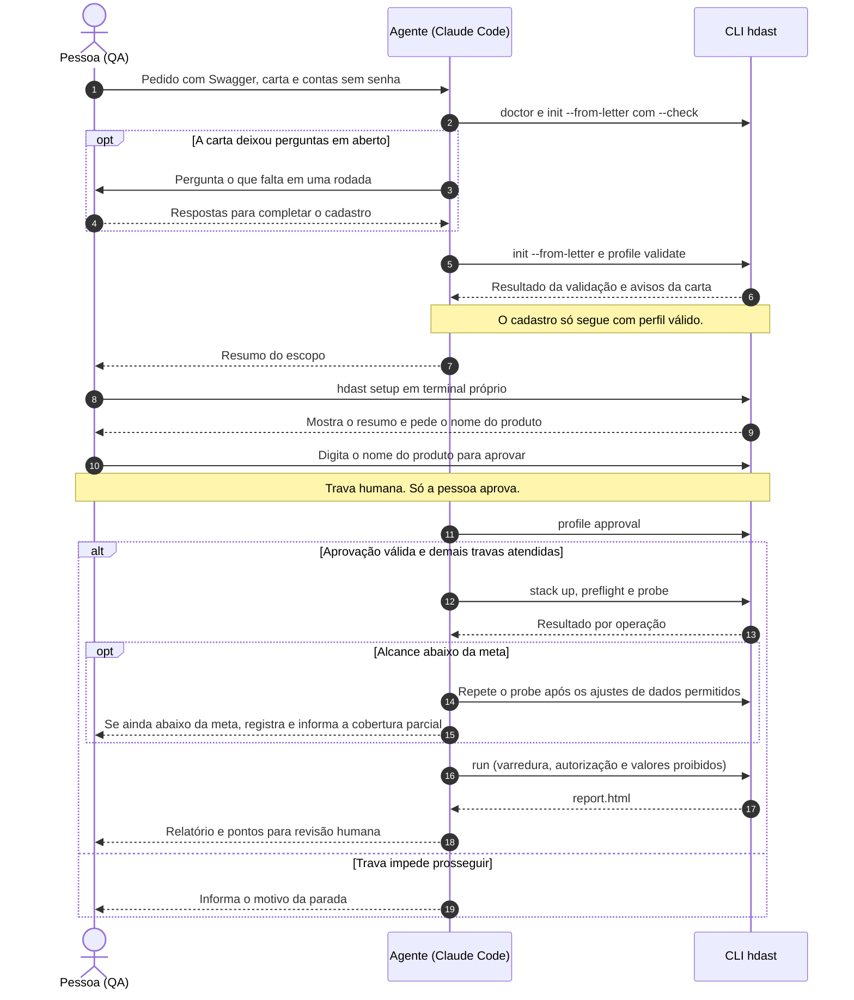

# Cadastrar um produto e operar com o agente

Peça ao Claude Code para conduzir o teste da API no ambiente de teste do produto. Entregue o Swagger (a descrição da API), a [carta](../referencia/glossario.md#carta) (autorização escrita do dono) e os dados das contas de teste sem as senhas. Para experimentar no laboratório, siga o [primeiro uso](../comecar/primeiro-uso.md).

A [cerca de escopo](../referencia/glossario.md#cerca-de-escopo) é a proteção que só deixa passar requisições permitidas. O [alcance](../referencia/glossario.md#alcance) (*reachability*) mede quantas das operações tentadas pelo `probe` tiveram sucesso ou a recusa de login esperada. Uma operação é uma ação da API definida por método e caminho.



## 1. O que pedir ao dono do produto

A [carta curta de autorização](carta-curta.md) preenchida e assinada, mais:

- o Swagger/OpenAPI do ambiente de teste (arquivo ou URL);
- contas de teste, uma por papel necessário, com as senhas por canal seguro entregues a **você**;
- se houver limpeza de dados: o script SQL, escrito e revisado por uma pessoa do time do produto (veja [limpeza-de-dados.md](limpeza-de-dados.md)).

Sem a carta, não comece. `scope`, `limits`, `authorization` e janelas do perfil vêm só dela, ou das suas respostas na entrevista (seção 5): o agente nunca os escreve; transcreve num `carta.yml` e a CLI gera.

## 2. Onde ficam os perfis

Perfis reais **ficam fora deste repositório** (o repositório só tem o modelo em `products/_template/`).

```powershell
mkdir C:\hdast-produtos                        # a pasta precisa existir
$env:HDAST_PRODUCTS_DIR = "C:\hdast-produtos"  # PowerShell; no Git Bash: export HDAST_PRODUCTS_DIR=/c/hdast-produtos
```

Cada produto é uma pasta com o nome do produto (`target.yml`, `data-rules.yml`, `flows.yml`, o OpenAPI e, se houver limpeza de dados, `cleanup/`, que o `init` só cria com `--with-cleanup`). Versione-as num repositório privado.

## 3. Como guardar os segredos

O perfil nunca tem senha. Ele tem uma referência, e o valor fica fora do repositório. São duas formas, e você escolhe por segredo:

**Cofre do sistema (recomendado no dia a dia): `secret_ref: "keyring:NOME"`.** Você grava uma vez, num terminal seu, e vale em todo terminal e em toda sessão; nada fica no histórico do shell:

```powershell
uv run hdast secret list meu-produto
```

O comando mostra quais segredos já existem, sem exibir os valores. Guarde as senhas nas referências indicadas pela carta durante a [aprovação do escopo](#5-a-entrevista-e-a-aprovação-do-escopo). Para gravar uma senha separadamente, use `uv run hdast secret set NOME` no seu terminal. Só a pessoa grava ou remove segredos do cofre. No Windows, o cofre usa o Gerenciador de Credenciais.

**Variável de ambiente: `secret_ref: "env:NOME"`** (CI, contêiner, ou se preferir), definida no terminal de onde abre o Claude Code:

```powershell
$env:MEU_PRODUTO_USER_A_LOGIN = "..."          # os nomes são os que a carta lista
$env:MEU_PRODUTO_USER_A_SENHA = "..."
```

Regras: nunca escreva senha em arquivo do repositório, em prompt nem em chat; não peça ao agente que leia `.env`. Se colar uma senha por engano, troque a senha da conta de teste. O cofre protege contra o histórico e contra arquivo esquecido, não contra um programa que rode na sua conta: a conta de teste continua tendo de ser descartável. O harness mascara segredos em relatórios, logs e auditoria, mas **o ambiente do terminal é visível ao processo do agente**: use contas de teste dedicadas, sem poder fora do ambiente de teste.

## 4. Abrir o Claude Code

Na raiz deste repositório, com `HDAST_PRODUCTS_DIR` definido, rode `claude`. Se usar referências `env:`, defina as variáveis no terminal antes de abrir o agente. No clone, abra com `claude --plugin-dir plugin/`: o Claude Code carrega as skills e os subagentes de `plugin/` e aplica as permissões da camada 0 de `.claude/settings.json`. A mesma configuração registra uma segunda camada, o hook `PreToolUse`, que verifica chamadas de shell e de ferramentas de arquivo.

Com `uv` no PATH e Python 3.12 disponível, o hook usa `uv run --no-project --quiet python "${CLAUDE_PROJECT_DIR}/plugin/hooks/guard.py"` em Windows e Linux. O Claude Code v2.1.295 ou posterior bloqueia falhas do lançador e tempo esgotado com `onFailure: block`. `--no-project` evita sincronizar as dependências do projeto a cada chamada. Ao detectar uma ação reservada, entrada inválida ou falha de processamento, o hook devolve código `2` e o Claude Code comunica o motivo ao agente. [ADR 0111](../decisoes/0111-hook-pretooluse-segunda-camada.md).

- O hook barra os comandos humanos, inclusive `hdast cleanup --dry-run`. Quem roda a simulação é você. [Limpeza de dados](limpeza-de-dados.md).
- O hook detecta clientes de rede conhecidos por caminho absoluto, dentro de `sh -c` e em formas listadas de código inline. Scripts que montam endereços em tempo de execução podem escapar. O isolamento de rede é a barreira física contra HTTP direto ao alvo e a avaliação cega verifica o transcript.
- Aprovações, confirmações humanas e arquivos que configuram o hook exigem alterações por uma pessoa. Skills e agentes continuam disponíveis para edição durante o desenvolvimento.
- A negação de escrita em `cleanup/` cobre `products/*/cleanup/` dentro do repositório. A pasta de produtos real fica **fora** dele (`HDAST_PRODUCTS_DIR`): proteja o script de limpeza com as permissões do sistema de arquivos e a revisão do time do produto.
- O processo do agente herda o ambiente do terminal. O hook barra formas conhecidas de listar variáveis e ler arquivos de segredo. Aplique também as regras da Parte B de `AGENTS.md`.
- As duas camadas também se aplicam ao Claude Code durante o desenvolvimento. A CLI continua impondo escopo e autorização durante a operação. [Testar o seu produto](../../README.md#testar-o-seu-produto).

## 5. A entrevista e a aprovação do escopo

Ao cadastrar, o agente lê a carta e o Swagger, monta um `carta.yml` com o que a carta diz (cada resposta com a origem: `carta`, `pessoa` ou `desconhecido`) e roda `hdast init <produto> --from-letter carta.yml --check`, que lista o que falta. Em seguida ele faz **uma rodada de perguntas** com tudo o que faltou, nesta ordem (perguntas fechadas em múltipla escolha, sempre com "Não sei / não está na carta"; abertas em texto):

1. **Portões:** o ambiente é de teste? Os dados são sintéticos? A autorização está vigente? Quem é o dono do produto? "Não" ou "não sei" encerra o cadastro.
2. **Endereço base** do ambiente de teste.
3. **O que pode e o que é proibido** (hosts, caminhos, métodos). Proibição usa curinga (`/api/admin/**`), nunca um id literal.
4. **Modo do caminho:** estrito (padrão) ou amplo. O amplo só vale se a carta disser; o agente nunca o sugere.
5. **Janela, validade e referência** da autorização.
6. **Limites:** requisições por segundo, duração máxima, threads. "Não sei" aqui usa o mínimo da CLI (1 req/s, 30 min, 1 thread; e 1 login por minuto no limite de logins), com aviso. É o único campo em que "não sei" vira valor.
7. **Contas:** apelido, papel e o **nome** do segredo (nunca a senha); se há duas contas do mesmo papel (o teste de autorização entre contas precisa).
8. **Escrita do teste entre contas:** a carta autoriza o teste a **escrever** no ambiente? Isso inclui verificar [atribuição em massa](../referencia/glossario.md#atribuição-em-massa), quando a API grava automaticamente campos que a conta não deveria poder alterar. O teste de leitura roda por padrão no `run`. "Não sei" vale não, e "sim" só vale com a frase da carta que o diz. Quem responde é o dono do produto.
9. **Força do ataque:** leve, média ou forte. Mais força testa mais variações e demora mais; o limite por segundo e a janela continuam valendo. Sem escolha, vale o padrão do perfil.
10. **Dados de exemplo** que existem no ambiente (um id, um nome de arquivo, um código válido). Eles ajudam o `probe` a marcar uma [operação como alcançada](../referencia/glossario.md#operação-alcançada) após uma resposta de sucesso ou uma recusa esperada de login.

**Pedido curto.** Você pode pedir em poucas linhas: o Swagger, as contas com papel (só o login, **nunca a senha**) e, se quiser, documentos `.md` de regra de negócio. Se colar uma senha, o agente avisa, não a usa e sugere trocar a senha da conta de teste. O agente pergunta só o que falta, numa rodada, em três grupos: **portões** ("não sei" para o cadastro: os quatro portões, endereço, o que pode, o que é proibido, referência, validade, janelas, tipo de login e contas), **padrão seguro** ("não sei" usa o mínimo da CLI e o agente diz qual) e **opcionais** (segunda conta do mesmo papel, dados de exemplo: "não sei" segue e o relatório anota).

**Pedido mínimo (sem carta assinada).** Quando você entrega só o Swagger, as contas e a documentação de negócio, o agente monta uma carta `kind: request` e faz **cinco perguntas numa rodada só**, cada uma com "Não sei / não está na carta": (1) é ambiente de teste, com dados sintéticos, e o dono do produto autorizou? Quem é o dono?; (2) qual o endereço do ambiente de teste (o `servers` do Swagger aparece só como sugestão, porque pode apontar para produção)?; (3) qual a força do ataque (`LOW` é a mais rápida e acha o que é mais evidente; `MEDIUM` equilibra tempo e profundidade; `HIGH` é bem mais lenta e põe mais carga no alvo); (4) o ambiente pode receber dados de teste gravados pela ferramenta?; (5) o Nuclei, que roda por padrão dentro das origens aprovadas, pode testar qualquer endereço do produto, inclusive fora do Swagger (os caminhos negados continuam negados)? "Não" ou "não sei" nas perguntas 1 e 2 encerra o cadastro; na 3 vale `LOW`; na 4 as três escritas ficam desligadas; na 5 os caminhos fora do Swagger ficam desligados. A CLI completa o resto com padrões fixos (escopo com todos os caminhos do Swagger sem `DELETE`, caminhos negados sugeridos por nome, validade de 30 dias, janela do dia inteiro, limites moderados e as capacidades extras ligadas). Cada padrão fica escrito no `target.yml`, aparece como aviso `REQUEST_DEFAULT_APPLIED` e vem no alto do resumo do `hdast setup`: **você** os confere e aprova. O agente lê a documentação de negócio para o encadeamento e os dados, e pode acrescentar caminhos negados, nunca tirar os sugeridos. Coloque o OpenAPI ao lado da carta: a CLI lê o escopo dele. Formato e tabela completa em [modelo-de-autorizacao.md](modelo-de-autorizacao.md#pedido-mínimo-kind-request).

O agente **não marca opção como recomendada** nem preenche escopo, limite, janela ou autorização por conta própria. "Não sei" entra como `desconhecido`. Nos quatro campos de padrão seguro (requisições por segundo, duração máxima, conexões simultâneas e logins por minuto), a CLI usa o mínimo fixo e avisa; em qualquer outro campo obrigatório, o agente para ali: quem responde é o dono do produto. Com tudo respondido, a CLI gera `environment`, `scope`, `limits`, as contas e a força do ataque no `target.yml`; o agente escreve só o que a carta não traz (`probe`, `auth.csrf`, `auth.account_map`, `data-rules.yml`, `flows.yml`).

Carta com autorização já vencida (`valid_until` no passado) é recusada com `AUTHORIZATION_EXPIRED`. Com a carta pronta, o agente também pode trazer **avisos** (`data.warnings`), que não bloqueiam nada: permissão com `/**` na raiz, método `DELETE` autorizado, nenhum caminho proibido, validade a mais de um ano e escrita do teste entre contas autorizada (`AUTHZ_WRITES_AUTHORIZED`). Ele os mostra a você, e você confirma com o dono do produto se é isso mesmo.

**O Nuclei no cadastro.** O Nuclei é o segundo motor: procura falhas conhecidas de produtos de prateleira, configuração errada e exposição fora do Swagger, atrás de uma segunda cerca. Três chaves o governam, e só a carta, a sua resposta ou o padrão do pedido mínimo as ligam, nunca o agente: `attack.nuclei` (usar o Nuclei), `attack.nuclei_login` (entrar com a conta de teste, só leitura) e `attack.nuclei_wide_paths` (**caminhos amplos**: qualquer caminho das origens aprovadas, inclusive fora do Swagger; os caminhos negados continuam negados). Na carta assinada cada chave exige a frase do dono (veja o [modelo](modelo-de-autorizacao.md#o-nuclei-na-carta-adr-0122)). **Escrita no Nuclei** não tem chave: ela só vale com as três escritas de dados já ligadas (a pergunta 4) e o `DELETE` só a pedido explícito. Com caminhos amplos e escrita, um modelo de CVE pode gravar dados no ambiente de teste: confirme com o dono se é isso mesmo. Os avisos `ATTACK_FLAG_AUTHORIZED` (caminhos amplos), `NUCLEI_WRITES_AUTHORIZED` e `NUCLEI_OPTION_INACTIVE` (login ou caminhos amplos sem o `nuclei`) aparecem junto dos outros e o `hdast setup` repete o resumo.

**A tabela "quem pode o quê" (opcional, é sua).** Para testar quem NÃO pode usar cada função (acesso vertical entre papéis que não formam uma escada), o agente roda `hdast authz <produto> --draft-matrix` (com `--run <run_id>` do `probe`, o `allow` vem preenchido pelo que o `probe` viu). Isso **não envia nada ao alvo** e grava só `authz-matrix.draft.yml` na pasta do produto, que o perfil não lê. O rascunho é uma hipótese: o `deny` vem **sempre vazio**, porque quem proíbe é o dono do produto. Você (com o dono) decide cada linha, o agente leva a tabela para `authz.access_matrix` do `target.yml` e valida, e **você** aprova o escopo de novo (o resumo mostra a tabela inteira). Papel que a tabela não cita não é testado, nunca é tratado como proibido. Detalhes em [authz.md](../referencia/authz.md).

Se a carta disser que contas de algum papel compartilham legitimamente seus recursos, registre os papéis em `attack.authz_shared_roles` com `source: carta` e a frase em `quote`. A CLI os leva a `authz.shared_roles`; isso deixa de comparar essas contas em `horizontal` e `horizontal_write`, com `shared_role` em `not_tested`. Não infira compartilhamento. Quando possível, distribua leituras distintas de cada tipo de objeto entre duas contas de um papel não compartilhado; cada operação aceita uma conta.

**Aprovação do escopo (você, num terminal seu).** Quando `profile validate` der `runnable: true`, o agente mostra o resumo e pede que **você** rode `hdast setup <produto>`. O comando grava as senhas `keyring:` que faltam. No alto do resumo, confira o endereço, os caminhos negados, as capacidades ligadas, as permissões de escrita, a validade e as janelas de execução. O comando também mostra os padrões do pedido mínimo, quando a carta é `kind: request`, e os padrões mínimos aplicados e pede que você digite o nome do produto para aprovar. Se só precisar aprovar, use `hdast profile approve <produto>`. Os dois comandos são reservados à pessoa. Sem aprovação válida, a CLI bloqueia o teste com `SCOPE_NOT_APPROVED`.

Antes de testar e após alterar o perfil, consulte `hdast profile approval <produto>`. Prossiga com `state: approved`. Se o estado for `changed`, leia os blocos alterados na saída (`data.changed_blocks` com `--json`) e peça nova aprovação à pessoa. A lista completa está na [referência do perfil](../referencia/target-yml.md#blocos-de-proteção-e-aprovação-humana).

## 6. Os prompts

**Um pedido só (skill `test-product`).** O agente conduz as quatro etapas abaixo. Veja [quando seguir com cobertura parcial e quando parar](../../plugin/skills/test-product/SKILL.md#se-der-x-faça-y-quando-parar-e-chamar-a-pessoa).

Um [achado](../referencia/glossario.md#achado) é um sinal de problema que aparece no relatório para revisão.

```text
Use a skill test-product no produto "<produto>". A pasta de produtos é <pasta>.
O OpenAPI está em <caminho ou URL>. A carta de autorização está em <caminho>;
use SOMENTE o que ela diz. É ambiente de teste com dados sintéticos e a
autorização vale agora. Se faltar dado, pergunte. No fim, me entregue os achados
altos para eu confirmar e o caminho do report.html.
```

Se preferir acompanhar etapa por etapa, ou retomar de uma etapa, use os prompts abaixo.

Troque o que está entre `<>`. Cada etapa usa uma skill e deixa um diário de decisões.

**Etapa 1. Cadastrar (skill `onboard-product`)** (conduz a entrevista da seção 5)

```text
Use a skill onboard-product para cadastrar o produto "<produto>".
A pasta de produtos é <pasta>. O OpenAPI está em <caminho ou URL>.
A carta de autorização está em <caminho>; use SOMENTE o que ela diz para
escopo, limites, autorização, janelas e limpeza. O que faltar, pergunte numa
rodada só (entrevista), sem sugerir valores. Termine pedindo a minha aprovação
do escopo.
Termine com "hdast profile validate" e "hdast spec inspect" limpos e registre
as decisões em decision-log.md na pasta do produto.
```

**Etapa 2. Alcançar os endpoints (skill `fix-reachability`)**

```text
Use a skill fix-reachability no produto "<produto>". Siga o critério de
parada da skill e registre cada rodada no diário de decisões.
```

**Etapa 3. Varrer (skill `run-scan`)**

```text
Use a skill run-scan no produto "<produto>". Confirme comigo que a janela
e a autorização valem agora. Suba a pilha, rode "hdast run", leia run.json
e me diga o código de saída, a cobertura e se o relatório é parcial. Não
rode limpeza: se houver comando de limpeza, só me informe.
```

**Etapa 4. Triar (skill `triage-findings`)**

```text
Use a skill triage-findings na execução <run_id> do produto "<produto>".
Proponha as anotações em triage.json (nunca mude severidade nem apague
achado), reemita o relatório e me entregue: achados que exigem ação humana,
suspeitas de falso positivo com o motivo e o que a varredura não cobre.
```

**Uma pessoa revisa tudo.** O agente propõe; a severidade e a confiança do relatório são propostas, e todo achado exige triagem humana.

## 7. Depois da varredura

- No resumo, uma [operação varrida](../referencia/glossario.md#operação-varrida) é uma ação da API que o ZAP chegou a testar. Uma [lacuna de cobertura](../referencia/glossario.md#lacuna-de-cobertura) indica o que ficou sem teste ou prova e por quê.
- Abra `runs/<run_id>/report.html` no navegador (uma página só, sem internet, para ler e compartilhar; comece pelo resumo e por "O que fazer agora"). O mesmo conteúdo está em `report.md` e `findings.json` (comece por "O que este relatório não testou").
- Nos testes de autorização, [BOLA](../referencia/glossario.md#bola) indica acesso indevido a um recurso. [BFLA](../referencia/glossario.md#bfla) indica acesso indevido a uma função.
- Se o Nuclei rodou, os achados dele (ids `U-`) vêm numa seção própria do relatório, com a gravidade fixada pela ferramenta. O que ele só identifica (tecnologias e versões) aparece em "Tecnologias identificadas" e não é achado. Sem achados do Nuclei **não** significa que o produto está livre de CVE.
- Depois de o time do produto aplicar uma correção, rode `uv run hdast retestar PRODUTO --run RUN_ANTERIOR`: ele repete só as operações dos achados e grava `retest.json` com `reproduced`, `not_reproduced` ou `not_tested`. "Não reproduzido nesta execução" não prova que a correção funcionou ([referência](../referencia/cli.md#hdast-retestar)).
- Para remover os dados de teste, siga [limpeza-de-dados.md](limpeza-de-dados.md): você roda, não o agente.
- Problemas: [problemas-comuns.md](problemas-comuns.md). Parar tudo: `uv run hdast stop`.
